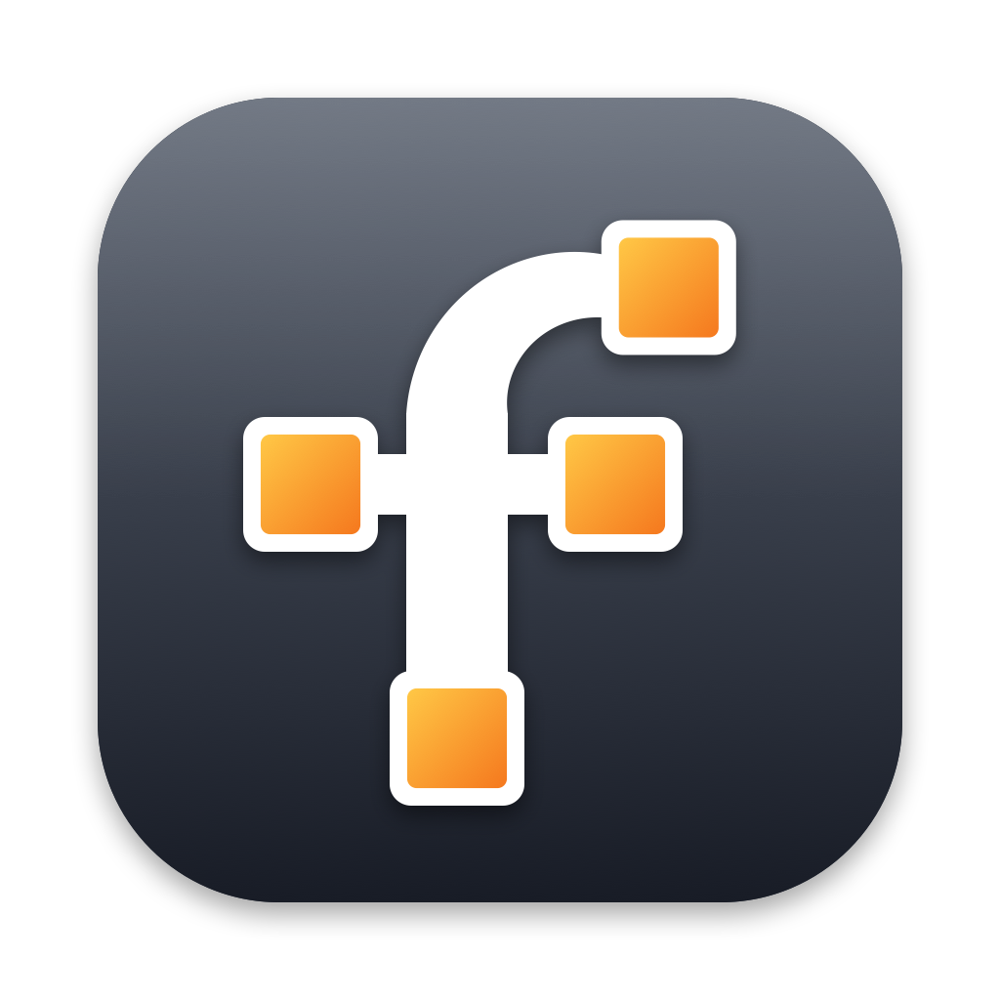

# freemonplay

Turn any spare laptop, tablet or PC into an extra monitor for your Mac, over the network. Free and open source.

The **host** (the computer that wants more screens) creates a real virtual monitor for each **client** that connects. The OS treats it like a plugged-in display: drag windows onto it, arrange it in Display settings, use your normal mouse on it. The host captures that monitor, encodes it as H.264 and streams it to the client. The client shows it full screen and sends touch, mouse and keyboard back.

Virtual monitors don't use the GPU's display engines, so the "1 or 2 external displays" limit on base Apple Silicon Macs doesn't apply. Each client is one more screen.

## Status

| Part | macOS | Windows | Linux |
|---|---|---|---|
| Client (view + input) | ✅ | builds (cross-compiled); not yet run on Windows | decoder path tested on macOS; not yet run on Linux |
| Host: virtual display | ✅ `CGVirtualDisplay` | planned: Virtual Display Driver (IDD) | planned: Mutter / wlroots / xrandr |
| Host: capture | ✅ ScreenCaptureKit | planned: Windows.Graphics.Capture | planned: PipeWire |
| Host: input injection | ✅ CGEvent | planned: SendInput | planned: libei / uinput |
| Host: hardware encoding | ✅ VideoToolbox (H.264, HEVC) | planned: Media Foundation / NVENC | planned: VAAPI |
| Client: decoding (H.264, HEVC) | ✅ VideoToolbox (hardware) | Media Foundation, DXVA on the GPU (software fallback) | GStreamer: VAAPI hardware, else system software decoder |

Tested so far: virtual display creation (including HiDPI) on macOS 15 / M4, plus the full network → encode → decode → render → input path using the host's `--test-pattern` mode. The real capture path needs Screen Recording permission (see below), so it hasn't been run end to end yet.

## Build

Requires Rust (`brew install rustup && rustup default stable`) and, on macOS, the Xcode Command Line Tools. Full Xcode isn't needed.

```bash
cargo build --release
```

Binaries end up in `target/release/freemonplay-host` and `target/release/freemonplay-client`.

**Linux client:** needs GStreamer's development files to build and its H.264 plugins to run. On Debian/Ubuntu:

```bash
sudo apt install libgstreamer1.0-dev libgstreamer-plugins-base1.0-dev gstreamer1.0-plugins-bad gstreamer1.0-libav intel-media-va-driver
```

Or build it from a Mac (or any machine with Docker), without a Linux box:

```bash
./build/linux/build.sh
```

That builds an x86_64 binary in an Ubuntu 22.04 container, at `target/linux-x86_64/release/freemonplay-client`. It runs on Ubuntu 22.04+, Debian 12+ and other distros from 2022 onwards. The target machine still needs GStreamer's runtime plugins: `sudo apt install gstreamer1.0-plugins-bad gstreamer1.0-libav intel-media-va-driver`.

`intel-media-va-driver` gives Intel GPUs (including low-power ones like Jasper Lake) hardware decoding; use `mesa-va-drivers` for AMD. Without GStreamer's H.264 plugins the client falls back to its bundled OpenH264. To force a particular GStreamer decoder, set `FMP_GST_DECODER` (for example `FMP_GST_DECODER=avdec_h264`).

**Windows client:** build natively with `cargo build --release -p freemonplay-client`, or cross-compile from a Mac:

```bash
brew install mingw-w64 && rustup target add x86_64-pc-windows-gnu
cargo build --release -p freemonplay-client --target x86_64-pc-windows-gnu
```

The `.exe` (in `target/x86_64-pc-windows-gnu/release/`) is self-contained and only uses DLLs that ship with Windows 10/11. Windows "N" editions need Microsoft's Media Feature Pack for video decoding.

## Use

On the Mac that wants more screens, install the menu bar app:

```bash
./build/macos/bundle.sh --install
```

Then open **freemonplay** from Launchpad or Spotlight. It lives in the menu bar (no Dock icon) and shows the pairing code, connected screens with live stats (frame rate, bitrate and estimated latency, with a breakdown per screen) and a Disconnect option for each, plus the codec, frame rate and input settings, Open at Login and the log. Install it to /Applications as above: macOS can stall apps that run from inside Documents, Desktop or Downloads behind file-access prompts.

On MacBooks with a notch, menu bar icons that don't fit are hidden behind it. If you can't see the freemonplay icon, open freemonplay again (from Spotlight or Launchpad) and its menu appears at the pointer, or Cmd-drag other icons to make room.

**Keep permissions across rebuilds (once per Mac):** macOS ties Screen Recording and Accessibility permissions to the app's signature. By default the app gets a throwaway (ad-hoc) signature, so every rebuild needs the permissions re-enabled. Create a local signing identity once and `bundle.sh` uses it automatically:

```bash
./build/macos/make-signing-identity.sh
```

It adds a self-signed "freemonplay Local Signing" certificate to your login keychain and asks for your password to trust it for code signing. It only affects apps you build on this Mac. Grant the permissions one more time after the first signed build; after that they stick.

You can also run it in a terminal, which prints the pairing code:

```bash
./target/release/freemonplay-host
```

The first run asks for two permissions (System Settings > Privacy & Security), for freemonplay when you use the app, or for your terminal app when you run it in a terminal:
- **Screen & System Audio Recording**, so it can capture the virtual displays. Restart the app or terminal after granting it.
- **Accessibility**, so clients can control the mouse and keyboard. Without it the screens are view-only.

On each device that should become a screen:

```bash
./freemonplay-client
```

It finds hosts on the LAN, asks for the pairing code the first time, then goes full screen. After pairing it reconnects without a code.

Useful options:

| | |
|---|---|
| `client --host 192.168.1.20` | Connect directly (skip discovery, e.g. across subnets) |
| `client --windowed 1280x800` | Run in a window instead of full screen |
| `client --monitor 1` | Fill a different monitor |
| `client --scale 2` | Force Retina-style 2x rendering (`auto` uses it on high-density screens) |
| `client --no-vsync` | Show frames without waiting for the display refresh: up to one refresh (about 16 ms at 60 Hz) less latency, but can tear |
| `host --max-fps 30 --bitrate-mbps 8` | Lower bandwidth |
| `host --encoder software` | Force the OpenH264 software encoder (default `auto` prefers hardware) |
| `host --codec h264` / `client --codec h264` | Limit to one codec (default `auto` negotiates; see below) |
| `host --no-input` | View only; ignore client input |
| `host --forget-clients` | Unpair every client |
| `host --test-pattern` | Stream a generated picture instead of a virtual display (no permissions needed; any OS) |
| `host --probe-display 2732x2048@2x` | Create a virtual display for 3 s to check the OS supports it |

Client shortcuts (not sent to the host): **Ctrl+Alt+Shift+F** toggles full screen, **Ctrl+Alt+Shift+Q** quits.

Quick test on one Mac: run the host, then `freemonplay-client --host 127.0.0.1 --windowed 1280x800`. A new display appears in System Settings > Displays. Drag a window onto it and it shows up in the client window.

## How it works

```
crates/
  proto/    wire protocol shared by both sides
  host/     mDNS advert, QUIC server, per-client session
    platform/macos/   virtual_display.rs, capture.rs, input.rs
    platform/macos/videotoolbox.rs   hardware H.264, zero-copy from capture
    encoder.rs        encoder selection; OpenH264 software fallback
  client/   discovery, QUIC client, wgpu renderer, input mapping
    decode/         videotoolbox.rs (macOS), mediafoundation.rs (Windows),
                    gstreamer.rs (Linux), software.rs (OpenH264 last resort)
```

- **Codecs:** the client lists the codecs it can decode, preferred first, and the host picks the first it can encode. Clients put HEVC first only when their GPU decodes it (HEVC is about 40% smaller than H.264 for the same quality, but costs more CPU in software). Hosts without a hardware HEVC encoder fall back to H.264.
- **Transport:** one QUIC connection per screen (`quinn`). Client to host is a control stream (hello, input, keyframe requests). Host to client is a video stream of H.264 access units. Messages are length-prefixed `postcard`.
- **Latency measurement:** each side times what it can on its own clock: the host from capture to sent, the client from received to shown, and QUIC tracks the round trip. The host adds them up (host + half the round trip + client) and shows the estimate in the menu. It leaves out capture's own delay and the wait for the client display's next refresh, so the real figure is somewhat higher.
- **Latency:** the host keeps only the newest captured frame. If encoding or the network falls behind, frames are skipped *before* encoding, so the picture never queues up. The client does the same after decoding.
- **Pairing:** the host has a self-signed certificate. A new client must send the host's pairing code; the host then issues a random token (it stores only its hash) and the client pins the host's certificate fingerprint. Five wrong codes rotate the code.
- **Display identity:** each client gets a stable serial number, so macOS remembers where you arranged that screen.

## Known limitations and next steps

- **Hardware encoding is macOS only.** On a Mac, captured frames go straight from ScreenCaptureKit into the hardware encoder with no copy (VideoToolbox's low-latency mode, Constrained High profile). Other hosts would fall back to OpenH264, which is CPU-hungry above 1440p.
- **Clients decode with the OS's decoder**: VideoToolbox on macOS, Media Foundation with DXVA on Windows, GStreamer (VAAPI where available) on Linux.
- **Mac clients draw the decoder's output directly** (zero copy, through a CoreVideo Metal texture cache): at 1080p60 that took client CPU from 11.7% to 3.6% and received-to-shown time from 27 ms to under 2 ms. Set `FMP_ZERO_COPY=0` to fall back to copying if a GPU ever misbehaves. Windows and Linux clients still copy decoded pictures through system memory.
- **HEVC on Windows clients** needs Microsoft's "HEVC Video Extensions" (often preinstalled by PC makers). Without them, Windows clients use H.264.
- **HEVC on Linux clients** is offered automatically only with a VAAPI HEVC decoder (`vah265dec`/`vaapih265dec`); `--codec h265` forces it in software via `avdec_h265`.
- **Bitrate control with the software encoder is loose.** Frame skipping is off to avoid stutter, and OpenH264 can't cap bitrate strictly without it. That's fine on a LAN.
- **First-pairing trust.** Someone actively intercepting your LAN during the very first pairing could sit in the middle. After pairing, the pinned fingerprint prevents this.
- **No GUI yet.** Both sides are command line tools. Next: a tray app for the host and a host picker for the client.
- **Windows and Linux hosts** aren't implemented yet (see `crates/host/src/platform/unsupported.rs` for the plan).
- **Touch** maps to a single-finger mouse. Multi-touch gestures aren't forwarded.

## Licensing notes

The code is MIT or Apache-2.0. H.264 is patent-encumbered:
- **Hardware path:** on macOS the encoding is done by Apple's built-in encoder, which ships licensed with the OS.
- **Clients** decode with the OS's decoder (Apple's, Microsoft's, or the distro's GStreamer plugins). macOS and Windows client builds contain no OpenH264 at all.
- **OpenH264** is compiled from source (BSD licensed) only for the host's software fallback encoder and the Linux client's last-resort decoder. Cisco's royalty coverage applies only to its own prebuilt binaries, not to builds from source.

That's generally a non-issue for personal use, but check before distributing binaries commercially.
