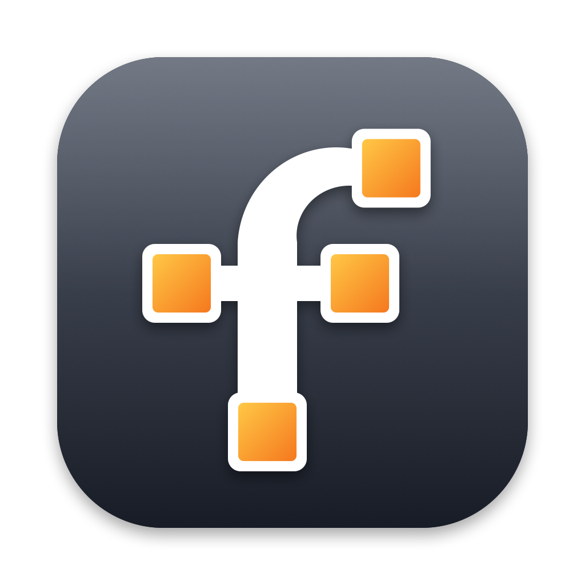

# Freemonplay

Turn any spare laptop, tablet or PC into an extra monitor for your Mac or Windows PC, over the network. Free and open source.

The **host** (the computer that wants more screens) creates a real virtual monitor for each **client** screen that connects. The OS treats it like a plugged-in display: drag windows onto it, arrange it in Display settings, use your normal mouse on it. The host captures that monitor, encodes it as H.264 and streams it to the client. The client shows it full screen and sends touch, mouse and keyboard back.

Virtual monitors don't use the GPU's display engines, so the "1 or 2 external displays" limit on base Apple Silicon Macs doesn't apply. Each client monitor is one more screen, and a client with several monitors can lend all of them.

See [CHANGELOG.md](CHANGELOG.md) for what's new, [ARCHITECTURE.md](ARCHITECTURE.md) for how it works and [BACKLOG.md](BACKLOG.md) for what's next.

## Status

| Part | macOS | Windows | Linux |
|---|---|---|---|
| One app with Host and Screen roles | ✅ | ✅ | Screen only |
| Client (view + input) | ✅ | ✅ (tested on a Surface, Iris Xe) | builds; not yet run on Linux |
| Host: virtual display | ✅ `CGVirtualDisplay` | ✅ preview: Virtual Display Driver (IDD), extends the desktop | planned: Mutter / wlroots / xrandr |
| Host: capture | ✅ ScreenCaptureKit | ✅ Windows.Graphics.Capture (GPU scaling to NV12) | planned: PipeWire |
| Host: input injection | ✅ CGEvent | ✅ SendInput | planned: libei / uinput |
| Host: hardware encoding | ✅ VideoToolbox (H.264, HEVC) | ✅ Media Foundation (H.264, HEVC), zero copy from capture | planned: VAAPI |
| Client: decoding (H.264, HEVC) | ✅ VideoToolbox (hardware) | ✅ Media Foundation, DXVA on the GPU (software fallback) | GStreamer: VAAPI hardware, else system software decoder |
| Client: zero-copy display | ✅ Metal | ✅ Direct3D 12 | planned |
| Client: several monitors | ✅ | ✅ (not yet tested with real extra monitors) | ✅ (untested) |

Tested end to end: a Mac host (macOS 15, M4) streaming to Mac and Windows clients over Wi-Fi. `freemonplay-screen --self-test` checks a machine's decoder and GPU path without a window.

An **iPad screen preview** is also available from source (iPadOS 16+, portrait and landscape). It
connects by address to the existing Mac and Windows hosts. See [the iPad build notes](build/ios/README.md).
An Xcode archive can be signed for TestFlight; end-to-end streaming still needs testing.

## Build

Requires Rust (`brew install rustup && rustup default stable`) and, on macOS, the Xcode Command Line Tools. Full Xcode isn't needed.

```bash
cargo build --release
```

Binaries end up in `target/release/freemonplay-host` and `target/release/freemonplay-screen`.

**Linux client:** needs GStreamer's development files to build and its H.264 plugins to run. On Debian/Ubuntu:

```bash
sudo apt install libgstreamer1.0-dev libgstreamer-plugins-base1.0-dev gstreamer1.0-plugins-bad gstreamer1.0-libav intel-media-va-driver
```

Or build it from a Mac (or any machine with Docker), without a Linux box:

```bash
./build/linux/build.sh
```

That builds an x86_64 binary in an Ubuntu 22.04 container, at `target/linux-x86_64/release/freemonplay-screen`. It runs on Ubuntu 22.04+, Debian 12+ and other distros from 2022 onwards. The target machine still needs GStreamer's runtime plugins: `sudo apt install gstreamer1.0-plugins-bad gstreamer1.0-libav intel-media-va-driver`.

`intel-media-va-driver` gives Intel GPUs (including low-power ones like Jasper Lake) hardware decoding; use `mesa-va-drivers` for AMD. Without GStreamer's H.264 plugins the client falls back to its bundled OpenH264. To force a particular GStreamer decoder, set `FMP_GST_DECODER` (for example `FMP_GST_DECODER=avdec_h264`).

**Windows client:** build natively with `cargo build --release -p freemonplay-screen`, or cross-compile from a Mac:

```bash
brew install mingw-w64 && rustup target add x86_64-pc-windows-gnu
cargo build --release -p freemonplay-screen --target x86_64-pc-windows-gnu
```

The `.exe` (in `target/x86_64-pc-windows-gnu/release/`) is self-contained and only uses DLLs that ship with Windows 10/11. Windows "N" editions need Microsoft's Media Feature Pack for video decoding.

## Use

Install **Freemonplay** from the [releases page](https://github.com/moridin1138/sw-freemonplay/releases)
on both computers. On Mac, drag Freemonplay from `freemonplay-macos.dmg` to Applications.
On Windows, run `freemonplay-windows-x64-setup.exe` as administrator. Open Freemonplay and choose a role tile:

- **Use as Host** on the computer that needs another monitor. The host lives in the
  Mac menu bar or Windows notification area and shows the pairing code. Open **Setup Guide…**
  there to check permissions and setup. The menu also shows connected screens, frame rate,
  bitrate and latency, and offers disconnect and host settings.
- **Use as Screen** on the computer that will display it. Select the host and enter
  its pairing code the first time.

To switch, select **Choose a role** in the host menu or at the top of the screen picker.
Leaving Host disconnects its screens. On a MacBook with a notch, choose Host again to
bring up its menu if the icon is hidden. If upgrading from separate apps, quit the old host
before starting the new one. Pairings and settings carry over; you can remove the old apps.

To build and install the unified Mac app from source:

```bash
./build/macos/bundle.sh --unified --install
```

Install to Applications: macOS can stall apps in Documents or Downloads behind file
access prompts.

**Keep permissions across rebuilds (once per Mac):** macOS ties Screen Recording and Accessibility permissions to the app's signature. By default the app gets a throwaway (ad-hoc) signature, so every rebuild needs the permissions re-enabled. Create a local signing identity once and `bundle.sh` uses it automatically:

```bash
./build/macos/make-signing-identity.sh
```

It adds a self-signed "freemonplay Local Signing" certificate to your login keychain and asks for your password to trust it for code signing. It only affects apps you build on this Mac. Grant the permissions one more time after the first signed build; after that they stick.

You can also run it in a terminal, which prints the pairing code:

```bash
./target/release/freemonplay-host
```

The first run asks for two permissions (System Settings > Privacy & Security), for Freemonplay when you use the app, or for your terminal app when you run it in a terminal:
- **Screen & System Audio Recording**, so it can capture the virtual displays. Restart the app or terminal after granting it.
- **Accessibility**, so clients can control the mouse and keyboard. Without it the screens are view-only.

On Linux, run the screen app from the release tarball. On iPad, use the
[iPad screen build](build/ios/README.md). The standalone `freemonplay-screen` command
and its options are still available for development.

To build the Windows installer yourself, use Inno Setup to compile
`build/windows/freemonplay.iss` after building both binaries and unpacking the driver
(see the script for paths).

A window lists the computers running Freemonplay on your network. Drag it to the monitor you want to use, click **Connect**, and enter the pairing code shown in the host's menu the first time (after that it reconnects without one). The screen fills that monitor; disconnecting brings the list back. If the connection drops out (Wi-Fi gone for a while), the screen reconnects by itself for 15 seconds, and the host keeps its display meanwhile so the windows on it stay put. Under **Monitors**, each of the device's monitors can be:
- **Screen for the host:** another screen for the Mac (arrange them in its Display settings; they're remembered).
- **Keyboard and mouse** (Windows and Mac clients; a Mac needs the Accessibility permission for it): stays the device's own, but the Mac's keyboard and mouse can move onto it, like Universal Control. With a streamed screen too, the Mac's pointer reaches these monitors by leaving that screen toward them, matching the device's own monitor layout. With no screen, they sit beside the Mac's main display, on the side chosen in the host's menu. **Ctrl+Alt+Shift+K** on the Mac takes them back from anywhere; "Mac shortcuts" makes Command act as Ctrl.
- **Not used.**

Copied text and images are shared both ways between the Mac and its screens (except passwords copied from password managers); turn it off with **Share Clipboard with Screens** in the Mac's menu or **Share the clipboard with the host** in the client's options.
 Hosts on other networks can be reached with **Connect by address**, and **Options** sets full screen, sharpness (1x/2x), codec, vsync, clipboard sharing, whether to keep the screen awake while connected (on by default) and whether the toolbar appears at the top edge while connected (on by default). The app remembers them.

Useful options:

| | |
|---|---|
| `client --host 192.168.1.20` | Connect straight away instead of showing the list (add `--code 123456` the first time) |
| `client --windowed 1280x800` | Stream in a window instead of full screen |
| `client --monitor 1` | Open the window on a different monitor |
| `client --all-monitors` | Use all of this device's monitors, each as its own screen |
| `client --keyboard-mouse` | No screens: the Mac's keyboard and mouse control all of this device's monitors (Windows, Mac) |
| `client --self-test` | Check this machine's video decoder and GPU display path, then exit (no window needed) |
| `client --scale 2` | Force Retina-style 2x rendering (`auto` uses it on high-density screens) |
| `client --no-clipboard` | Don't share copied text with the host |
| `client --allow-sleep` | Let the screen dim, lock or sleep while connected (by default it's kept awake) |
| `client --no-vsync` | Show frames without waiting for the display refresh: up to one refresh (about 16 ms at 60 Hz) less latency, but can tear |
| `host --max-fps 30 --bitrate-mbps 8` | Lower bandwidth |
| `host --encoder software` | Force the OpenH264 software encoder (default `auto` prefers hardware) |
| `host --codec h264` / `client --codec h264` | Limit to one codec (default `auto` negotiates; see below) |
| `host --no-input` | View only; ignore client input |
| `host --forget-clients` | Unpair every client |
| `host --test-pattern` | Stream a generated picture instead of a virtual display (no permissions needed; any OS) |
| `host --probe-display 2732x2048@2x` | Create a virtual display for 3 s to check the OS supports it |

Client shortcuts while connected (not sent to the host): **Ctrl+Alt+Shift+D** disconnects all screens (back to the list), **Ctrl+Alt+Shift+F** toggles full screen, **Ctrl+Alt+Shift+Q** quits.

Quick test on one Mac: run the host, then `freemonplay-screen --host 127.0.0.1 --windowed 1280x800`. A new display appears in System Settings > Displays. Drag a window onto it and it shows up in the client window.

### Windows as the host (preview)

Choose **Use as Host** in Freemonplay. To extend the desktop, install the
Virtual Display Driver and allow the firewall rule from the host's **Setup Guide…**.
These steps need administrator rights. The installer includes the signed, MIT licensed
driver, with three virtual monitors and common resolutions including Mac Retina sizes.
Uninstalling Freemonplay leaves the driver installed because other apps may use it.

Freemonplay then lives in the notification area by the clock (under the ^ arrow if Windows hides it). Its menu matches the Mac's: the pairing code, connected screens with live stats and Disconnect, the codec, frame rate, input and clipboard settings, Start at Sign-in and the log. The first time, a setup dialog checks the driver and the firewall rule (installing either with one click) and shows the pairing code; **Setup Guide…** in the menu brings it back.

Each screen that connects extends the desktop onto its own virtual monitor, removed again when it disconnects. Each gets that screen's own display scale (a Retina Mac 200%, a PC at 150% 150%), so text appears the size it would there. Without the driver, screens mirror the primary monitor.

Without the installer, build `freemonplay-host` and run, as administrator, `freemonplay-host --install-display-driver <folder> --allow-firewall`, where the folder is the unpacked `VirtualDisplayDriver-x86.Driver.Only.zip` (or put it in a `driver` folder beside `freemonplay-host.exe` and use the setup dialog). `--uninstall-display-driver --remove-firewall` undoes both. `freemonplay-host --no-tray` runs in a terminal instead of the notification area.

## Languages

Both roles follow the computer's language: English, German, Spanish, French, Turkish and Simplified Chinese so far. Translations are plain text files in [`locales`](locales), one per language, and new ones are welcome: see [CONTRIBUTING.md](CONTRIBUTING.md).

## How it works

One QUIC connection per screen: the host captures its virtual display, hardware encodes it (H.264 or HEVC, negotiated) and streams it; the client decodes with the OS's decoder, draws it with wgpu and sends input back. Pairing uses SPAKE2 with the host's 6 digit code, after which the client reconnects with a token. Frames are skipped rather than queued whenever anything falls behind, so the picture never lags. Details, including threads, zero copy, several monitors and the protocol, are in [ARCHITECTURE.md](ARCHITECTURE.md).

## Known limitations and next steps

- **iPad preview:** manual host address, one screen, no clipboard sharing or
  keyboard and mouse mode. Leaving the app disconnects the session. TestFlight archive builds are supported.

- **Hardware encoding is macOS only.** On a Mac, captured frames go straight from ScreenCaptureKit into the hardware encoder with no copy (VideoToolbox's low-latency mode, Constrained High profile). Other hosts would fall back to OpenH264, which is CPU-hungry above 1440p.
- **Clients decode with the OS's decoder**: VideoToolbox on macOS, Media Foundation with DXVA on Windows, GStreamer (VAAPI where available) on Linux.
- **Mac and Windows clients draw the decoder's output directly** (zero copy). On a Mac at 1080p60 that took client CPU from 11.7% to 3.6% and received-to-shown time from 27 ms to under 2 ms; on a Surface it cut decoding from 4.9 to 1.8 ms per frame. Set `FMP_ZERO_COPY=0` to fall back to copying if a GPU ever misbehaves. Linux clients still copy decoded pictures through system memory.
- **Wi-Fi adds most of the latency.** A typical figure is about 50 ms in total, of which the network is roughly two thirds. The host's menu shows each side's link and what to improve: wired Ethernet or 5 GHz Wi-Fi on *both* computers matters most, and on a Mac, AirDrop, Handoff and Universal Control (AWDL) can cause latency spikes. The bitrate adapts when the network falls behind; Windows clients also switch on Wi-Fi media streaming mode while connected.
- **HEVC on Windows clients** needs Microsoft's "HEVC Video Extensions" (often preinstalled by PC makers). Without them, Windows clients use H.264.
- **HEVC on Linux clients** is offered automatically only with a VAAPI HEVC decoder (`vah265dec`/`vaapih265dec`); `--codec h265` forces it in software via `avdec_h265`.
- **Bitrate control with the software encoder is loose.** Frame skipping is off to avoid stutter, and OpenH264 can't cap bitrate strictly without it. That's fine on a LAN.
- **Linux packaging** is a tarball with a desktop entry; there's no AppImage or Flatpak yet.
- **The Windows host is a preview:** keyboard and mouse mode with Windows as the host is new and not yet tested on a real setup, and the virtual monitors come from a fixed set of three with a list of resolutions (screens with other sizes get the closest of the same shape).
- **Linux hosts** aren't implemented yet (see `crates/host/src/platform/unsupported.rs` for the plan).
- **Touch** maps to a single-finger mouse. Multi-touch gestures aren't forwarded.

## Security warnings when installing

Freemonplay is free and open source, made by one developer, and its downloads aren't signed with a paid certificate (Apple charges US$99 a year, and Windows signing about US$120 a year). So macOS and Windows can't tell who made them, and warn you the first time. That doesn't mean anything is wrong with the app, but here's what to expect and how to check what you're running.

**Mac:** opening the app the first time shows "Apple could not verify…". Choose Done, then go to System Settings > Privacy & Security, scroll down, choose **Open Anyway** next to Freemonplay, and confirm. You do this once per download. Because the apps aren't signed by Apple, macOS also asks again for Screen Recording and Accessibility after each update.

**Windows:** SmartScreen may show "Windows protected your PC". Choose **More info**, then **Run anyway**. On PCs with **Smart App Control** turned on (Windows Security > App & browser control), Windows blocks unsigned apps outright and offers no way to run them. Turning Smart App Control off is possible, but Windows only lets you turn it back on by resetting or reinstalling Windows, so decide that for yourself.

**Linux:** no warnings.

**How to know what you're getting:**

- Every download on the [releases page](https://github.com/moridin1138/sw-freemonplay/releases) is built by this repository's GitHub Actions workflows from the public source code of that release, not on anyone's own computer. GitHub shows each file's SHA-256 checksum on the releases page, so you can check that your download matches.
- You can read every line of the source here, and [build the apps yourself](#build) if you'd rather.
- The Windows installer contains the [Virtual Display Driver](https://github.com/VirtualDrivers/Virtual-Display-Driver) (MIT licensed), unchanged and still signed by its own publisher.
- Freemonplay talks only to the computers you connect it to on your own network (and announces itself there, so they can find it). It doesn't send information anywhere else unless you ask it to, such as opening the download page from the setup window. See the [privacy policy](PRIVACY.md).

Signing may come later if the project grows enough to cover the cost; the release workflows are ready for it ([SIGNING.md](SIGNING.md)).

## License

Copyright (C) 2026 moridin1138

Freemonplay is free software: you can redistribute it and/or modify it under the terms of the GNU General Public License as published by the Free Software Foundation, either version 3 of the License, or (at your option) any later version. It is distributed in the hope that it will be useful, but WITHOUT ANY WARRANTY; without even the implied warranty of MERCHANTABILITY or FITNESS FOR A PARTICULAR PURPOSE. See [LICENSE](LICENSE) for details.

In short: anyone can use, study, change and share it, but anything distributed that includes it must also be GPL, with source.

All dependencies are under GPL-compatible licenses (MIT, Apache-2.0, BSD, ISC, Zlib and one MPL-2.0 crate). On Linux the client uses the system's GStreamer (LGPL) through dynamic linking.

### H.264 and HEVC patents

These codecs are patent-encumbered, separately from copyright:
- **Hardware paths:** encoding on macOS and decoding on macOS and Windows use the operating system's built-in codecs, which ship licensed with the OS. On Linux the codecs come from the distribution's GStreamer plugins.
- **OpenH264** is compiled from source (BSD licensed) only for the host's software fallback encoder and the Linux client's last-resort decoder. Cisco's royalty coverage applies only to its own prebuilt binaries, not to builds from source.

That's generally a non-issue for personal use, but check before distributing binaries commercially.
